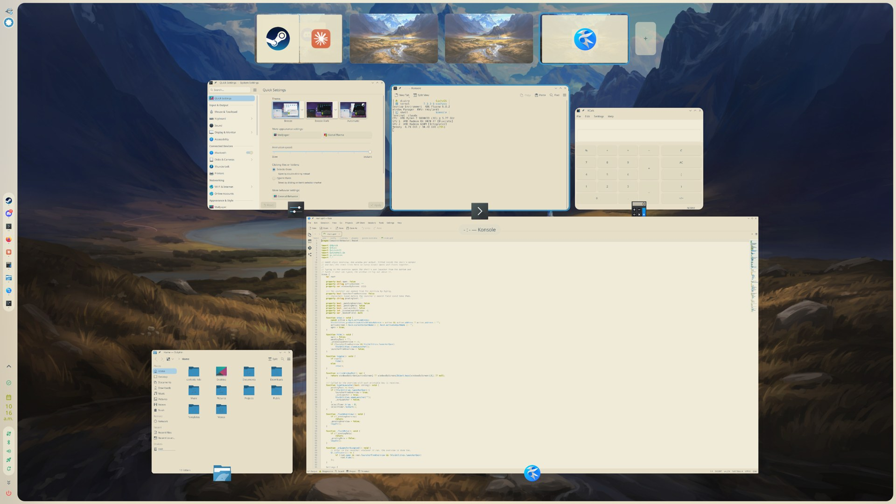
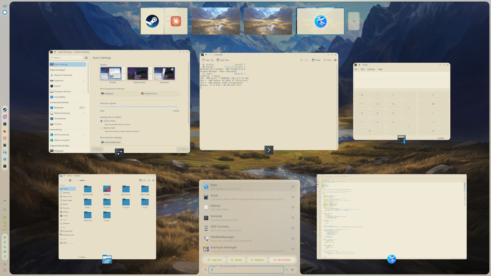
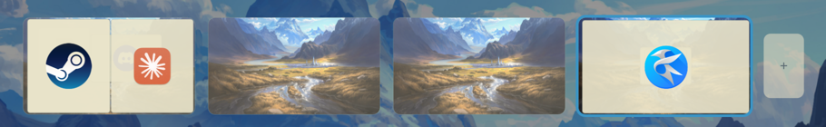

# GNOME-Inspired Overview for Caelestia

A GNOME-inspired activities overview for the [Caelestia](https://github.com/caelestia-kde/caelestia) shell on KDE Plasma 6.
Press **Meta** to see every window on the current workspace as a live preview, with your workspaces
along the top. Start typing and the shell's launcher rises from the bottom while the windows make room for it.



## Features

- **Live window previews** of the current workspace, laid out to fill the screen inside the shell's border and bar.
- **Workspace strip** along the top: click a thumbnail to switch, drag a window onto one to move it,
  `+` to add a workspace, and the × on a hovered thumbnail (or a middle-click) to remove one.
- **Type to search.** Typing opens the shell's own launcher with what you typed. The windows flow
  around it, above and to either side, and reflow as the results change.
- **Works with the launcher open.** Hovering a window still highlights it, and one click opens it.
- **Keyboard-driven.** Arrows and Tab move between windows, Enter focuses one, Page Up/Down change workspace.
- Replaces the built-in overview on **Meta+Tab**, and optionally on **Meta** alone.





## Requirements

- KDE Plasma 6 on Wayland
- caelestia-kde shell **2.6.3** or newer

## Installation

Install it from Caelestia's own plugin settings:

1. Open **Settings → System & Services → Caelestia Plugins**.
2. On the **Installed** tab, under **Install from source**, paste this repository's URL into **Git URL**:

   ```
   https://github.com/BlazeJewell/gnome-inspired-overview
   ```

3. Click **Install**, then **Restart Shell** when the shell asks for it.

Once it's in the [Caelestia community plugin store](https://github.com/caelestia-kde/plugins),
you can install it from the **Store** tab of the same page instead.

Plugins run with the same privileges as the shell, so only install plugins you trust.

## Usage

| Input | Action |
| --- | --- |
| **Meta** or **Meta+Tab** | Open or close the overview |
| Type anything | Open the launcher and search |
| Enter | Focus the selected window |
| Arrows, Tab | Move between windows |
| Page Up / Page Down, scroll | Previous / next workspace |
| Esc | Close the launcher, then the overview |
| Click a window | Focus it |
| Middle-click a window | Close it |
| Drag a window onto a thumbnail | Move it to that workspace |
| Middle-click a thumbnail, or its × | Remove that workspace (its windows move to the next one) |

## Settings

Found in **Settings → System & Services → Caelestia Plugins**, under GNOME-Inspired Overview:

| Setting | Default | What it does |
| --- | --- | --- |
| Replace the built-in overview (Meta+Tab) | On | Meta+Tab opens this overview instead of the shell's own. |
| Meta opens the overview | On | Meta opens this overview instead of the launcher; type to get the launcher. |
| Show app icons in workspace thumbnails | On | Draws each workspace's app icons on its thumbnail. |

## IPC

```bash
caelestia shell gnomeOverview toggle         # open or close
caelestia shell gnomeOverview close          # close
caelestia shell gnomeOverview type <text>    # open and type into the launcher
caelestia shell gnomeOverview snapshot <png> # save the active output's overview to an image
```

## How it works

The plugin draws one overview window per output on the layer-shell top layer, so the shell's border
and bar stay visible around it. Window previews are live streams from KWin.

Plugins get no direct handle on the shell's launcher, so the overview finds it at runtime by walking
the shell's drawer window from the bar on the same output. While the launcher is open the shell
catches all pointer input, so the overview places a passive pointer probe in the shell's window to keep
hover and click working.

A shell update that renames those internals could break typing-to-search or the launcher layout.
The rest of the overview keeps working.

## Files

| File | Purpose |
| --- | --- |
| `metadata.json` | Plugin id, version, compatibility and settings |
| `main.qml` | Shared state, shortcuts, launcher hand-off and IPC |
| `OverviewWindow.qml` | The per-output overview, window layout and launcher flow |
| `WindowCard.qml` | One live window preview |
| `WorkspaceStrip.qml` | The workspace thumbnails |
| `screenshots/` | Images used in this README |

## License

[MIT](LICENSE)
